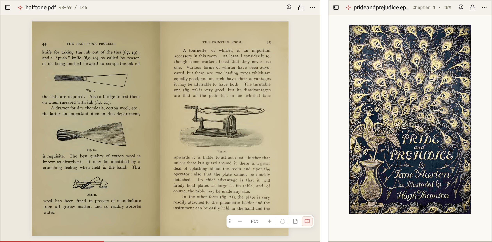
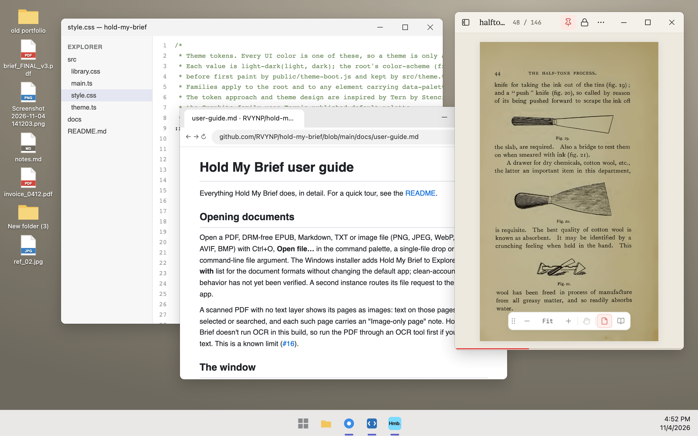
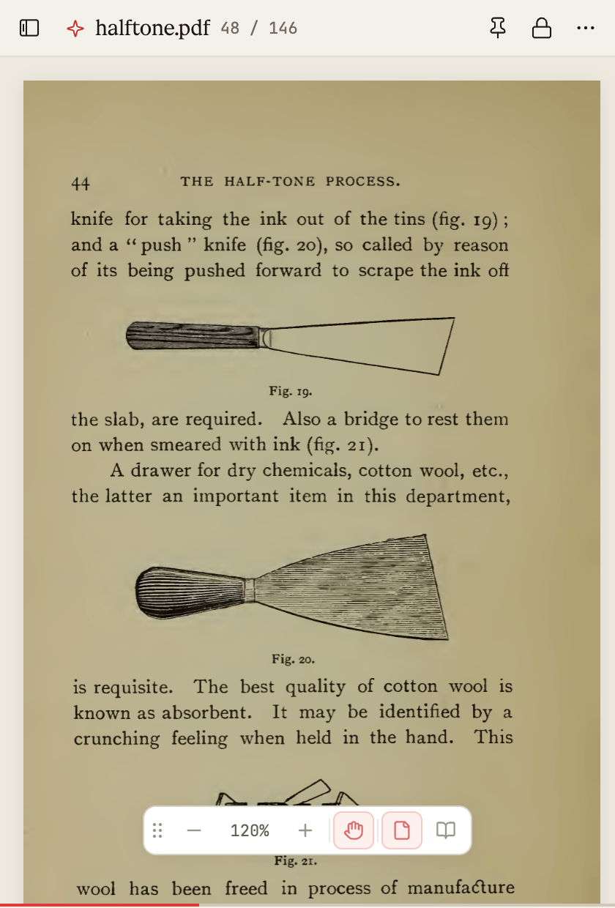
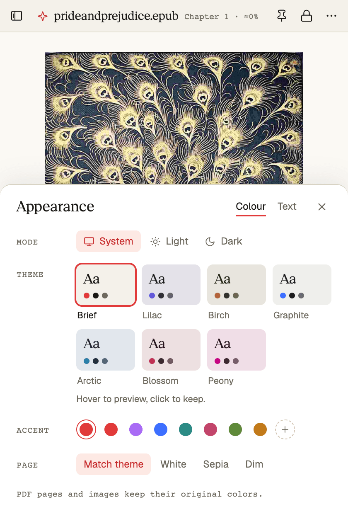
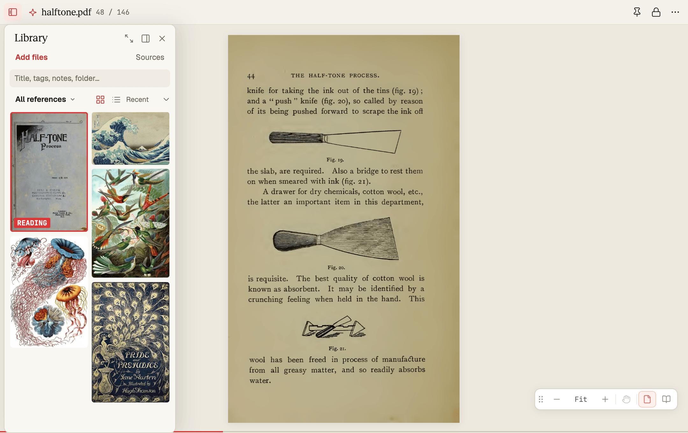
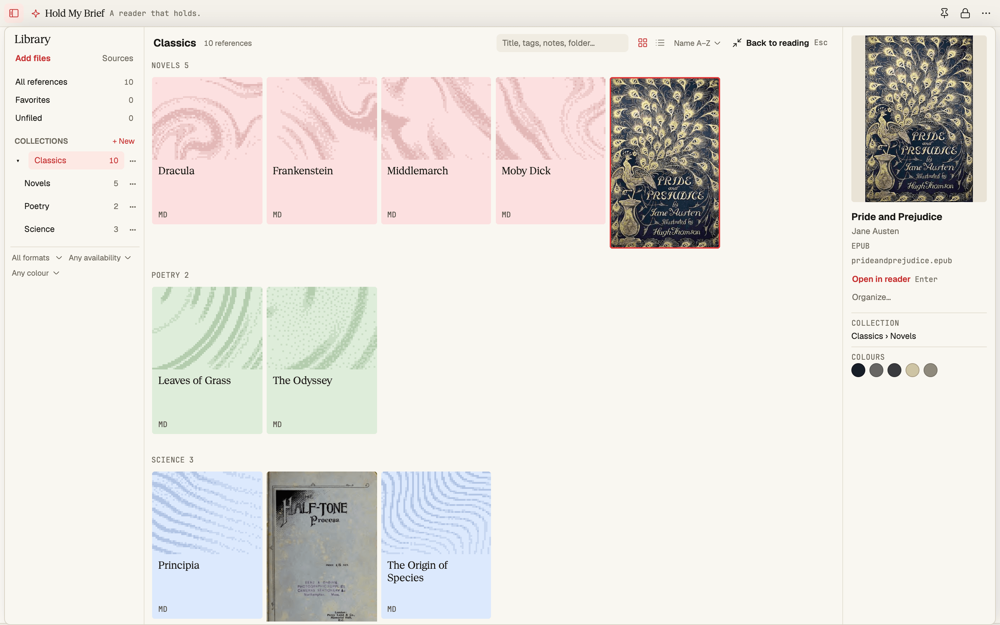
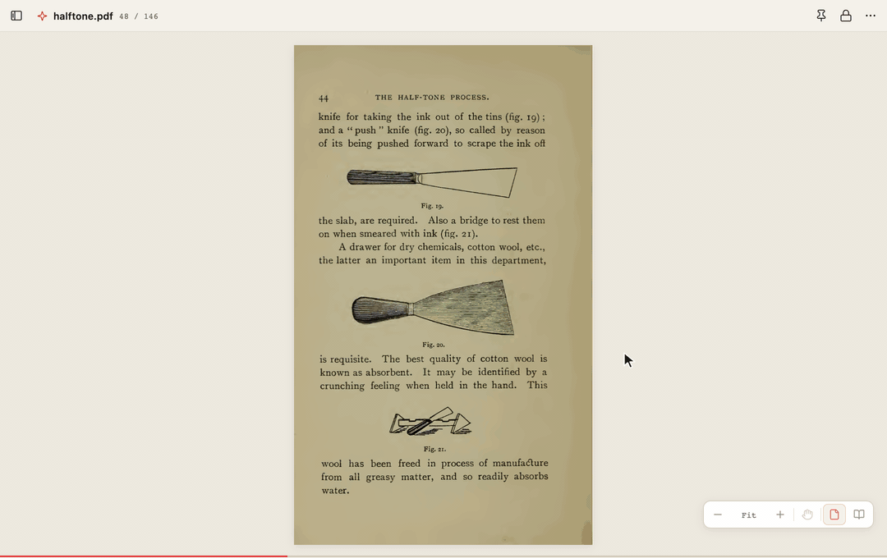
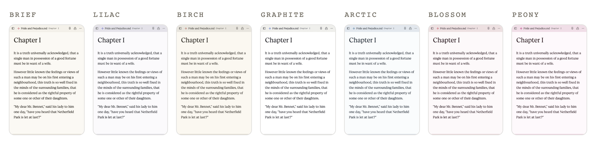
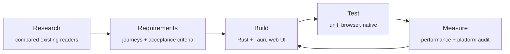

<p align="center">
  
</p>

<h1 align="center">Hold My Brief</h1>

<p align="center">
  <b>A reader that holds.</b><br>
  A small reading window that stays on top of your work and remembers exactly where you left off.
</p>

<p align="center">
  
  
  
  <a href="LICENSE"></a>
</p>

<p align="center">
  <a href="#download"><b>Download for Windows or Mac</b></a> · <a href="docs/user-guide.md">User guide</a>
</p>

---

## Why it exists

Reading something *while* you work (a spec beside a design file, a paper beside your notes, a book on a
second screen) usually means juggling a full-size viewer: switching windows, resizing, scrolling to
find your place again.

Hold My Brief is a pocket-sized window built for that. Pin it above everything else, lock its size so
it never gets in the way, and pick up on the same passage tomorrow. It opens the formats people
actually read (PDF, EPUB books, Markdown, plain text and images), and your files never leave your
computer.

<p align="center">
  
  <br><sub><b>Pinned</b> above an editor, a browser and a desktop full of files</sub>
</p>

> **Note:** Hold My Brief was previously developed under the name **Float Reader**. The rename
> moves the application-data folder (see the [user guide](docs/user-guide.md#saved-reading-data));
> saved reading positions and libraries from Float Reader builds are not migrated.

## What it does

<table>
  <tr>
    <td width="50%" valign="top">
      <h3>Stays where you put it</h3>
      <b>Pin</b> keeps the window above other apps. <b>Lock</b> fixes its size, so you can still move
      it but never resize it by accident.
    </td>
    <td width="50%" valign="top">
      <h3>Remembers your place</h3>
      Close a book and reopen it next week, even after renaming the file, and you're back on the
      same page, chapter or line.
    </td>
  </tr>
  <tr>
    <td valign="top">
      <h3>Reads what you read</h3>
      PDFs, EPUB books, Markdown notes, plain text and images: faithful pages for PDFs, comfortable
      reflowing text for books. Click the title or press Ctrl+K and type a page number, a phrase or a
      command to go straight there; the hairline under the page scrubs the whole document.
    </td>
    <td valign="top">
      <h3>Opens like a book</h3>
      Show two pages side by side, the way a printed book lies open. Zoom in on a small detail and
      drag the page around by hand; if the zoom controls are in the way, drag them somewhere else.
      Every control also works from the keyboard.
    </td>
  </tr>
  <tr>
    <td valign="top">
      <h3>A library for your references</h3>
      Collect PDFs, EPUBs, Markdown and text into collections, star favorites and search, or index a
      folder of them (index it again to pick up changes). Collections with sub-collections show as
      shelves. An EPUB shows the title and cover from inside the book; a document without a cover gets
      its own generated, dithered one, which you can re-roll with ↻. Browse as a grid of thumbnails at
      their real proportions, or as a list. New arrivals open in an intake sheet where you can review
      covers and titles or move a shelf. The library is a drawer over the page: widen it, narrow it or
      move it to either side without the page ever moving. It never copies or moves your files.
    </td>
    <td valign="top">
      <h3>Fits your space</h3>
      One slim toolbar, and a footer that is only a progress line until you reach for it, leave the
      page 94% of the window; a pinned reader's controls fade while you work in another app. Light and
      dark modes that follow your system, seven theme families (Brief by default, two of them pink),
      your own accent color, and a page tone for text. Every theme keeps its text at AA contrast, and
      nothing is set smaller than 11 px. Hover a theme to preview it on the whole window.
    </td>
  </tr>
  <tr>
    <td colspan="2" valign="top">
      <h3>Ask it, if you want to</h3>
      Turn on the optional AI assistant with your own Anthropic, OpenRouter or OpenAI API key (one at a
      time, kept in your system keychain), then choose <b>Ask the assistant</b> from the command palette
      and type a question: "where does Darcy first appear?", "summarize this chapter", "open the Tauri
      docs and switch to dark". It answers from the page you're on, and moves, opens or restyles the
      reader for you, listing each thing it did. It stays off until you add a key.
    </td>
  </tr>
</table>

## A closer look

<table>
  <tr>
    <td align="center" width="50%"><br><sub><b>Zoom in</b>, then drag the page with the hand tool</sub></td>
    <td align="center" width="50%"><br><sub><b>Appearance</b>: hover to preview, click to keep. Text size and spacing are on its Text tab</sub></td>
  </tr>
</table>

<p align="center">
  
  <br><sub><b>The library</b> floats over the page as a grid of thumbnails or a list. Put it on either side and the page keeps its place</sub>
</p>

<p align="center">
  
  <br><sub><b>Shelves</b>: a collection with sub-collections groups its books by shelf. Books without a cover get a generated one in their shelf's colours</sub>
</p>

<p align="center">
  
  <br><sub><b>Make it wider</b>: open the drawer, drag the divider, double-click to reset. The page never moves</sub>
</p>

<p align="center">
  
  <br><sub><b>Seven theme families</b>, each with a light and a dark version, two of them pink. Brief is the default</sub>
</p>

## Private by design

- **Your files stay yours.** No account, no cloud, no analytics. It works offline.
- **AI is off unless you turn it on.** The optional assistant uses your own API key from Anthropic,
  OpenRouter or OpenAI (one at a time), kept in the system keychain. Only when you ask something does
  it send your question and the text it reads to answer it to that provider; OpenRouter forwards the
  request to the provider of the model you pick. Without a key, the app makes no network requests.
- **Documents are never changed.** Reading positions and the library live in a small local data
  folder. Removing something from the library never deletes the file.
- **Nothing runs behind your back.** Scripts inside documents are blocked, books open in a sandbox,
  and web links open only when you click them.

## How it was made

Hold My Brief was planned before it was built, and every claim about it is backed by a test or a
measurement.



| Step | What it produced |
| --- | --- |
| **Research** | A [research brief](docs/floating-reader-research-2026-10-22.md) comparing Readest, Thorium, Koodo, SumatraPDF and PowerToys "Always on Top": what each does well and where none of them fit this use case. |
| **Requirements** | A [product requirements document](docs/floating-reader-prd.md) with user journeys, priorities and testable acceptance criteria for every behavior. For example, "locking the size must survive snapping, maximize and display changes". |
| **Build** | A native Rust/Tauri shell for files, windows and saved state, plus a small web interface using PDF.js, foliate-js and markdown-it. The Windows app is a single ~7 MB executable. |
| **Test** | Unit tests, real-browser scenarios and native tests run on Windows and macOS in [CI](.github/workflows/ci.yml) for every change, including a smoke test that drives the real desktop app. |
| **Measure** | A [performance pass](docs/floating-reader-performance.md) that halved PDF time-to-first-page (248 → 128 ms) and made flipping back and forth through 120 pages 16× faster (2,000 → 122 ms). |

The [implementation status](docs/floating-reader-implementation.md) separates what is verified
from what isn't yet. Hold My Brief is a working release candidate, not a finished 1.0. Open items
such as screen-reader testing and very large files are listed there, not glossed over.

## Download

Get the newest version from the
[latest release](https://github.com/RVYNP/hold-my-brief/releases/latest). There's nothing to
sign up for.

| Your computer | File to download |
| --- | --- |
| **Windows** (64-bit) | `Hold-My-Brief-0.1.0-windows-x64-setup.exe` installs it just for you, no administrator needed. Prefer not to install? Unzip `Hold-My-Brief-0.1.0-windows-x64-portable.zip` anywhere and run **Hold My Brief.exe**. |
| **Mac** with Apple silicon (M1 or later) | `Hold-My-Brief-0.1.0-macos-arm64.dmg`. There's no version for Intel Macs yet. |

The version number in each file name changes with every release. To check a download, compare it
with `SHA256SUMS.txt` on the same page.

**The first time you open it.** Hold My Brief isn't signed with a paid Apple or Microsoft developer
certificate yet, so your computer asks you to confirm once:

- **Windows:** if a blue "Windows protected your PC" screen appears, choose **More info**, then
  **Run anyway**.
- **Mac:** open the `.dmg` and drag Hold My Brief to Applications. The first time you open it, macOS
  says *"Apple could not verify 'Hold My Brief' is free of malware that may harm your Mac or
  compromise your privacy."* That's the standard message for any app that hasn't been through
  Apple's paid notarization service. It doesn't mean anything was found. To open it:
  - On macOS 15 (Sequoia) or later, click **Done**, open **System Settings › Privacy & Security**,
    scroll down, click **Open Anyway**, then confirm with your password or Touch ID.
  - On macOS 14 or earlier, Control-click (or right-click) the app, choose **Open**, then **Open**
    again.
  - Prefer Terminal? Check the download against `SHA256SUMS.txt` first, then run
    `xattr -dr com.apple.quarantine "/Applications/Hold My Brief.app"` once.

**Let an AI assistant do it.** If you use an AI coding assistant, give it the
[agent setup instructions](docs/agent-setup.md). It will pick the right download, check it, install
it, and tell you what it did.

### Build it yourself

Developers can build from source with Node.js and Rust; the
[development guide](docs/development.md) covers Windows and macOS step by step.

```bash
npm ci
npm run desktop     # launches the app
npm run dev         # or try the interface in a browser
```

## Learn more

| | |
| --- | --- |
| [User guide](docs/user-guide.md) | Every feature, shortcut and setting in detail |
| [Development guide](docs/development.md) | Build, test and package for Windows and macOS |
| [Requirements](docs/floating-reader-prd.md) · [Research](docs/floating-reader-research-2026-10-22.md) | Why it works the way it does |
| [Status](docs/floating-reader-implementation.md) · [Performance](docs/floating-reader-performance.md) · [macOS audit](docs/floating-reader-macos-and-performance-audit.md) | What's verified, what's measured, what's next |

## Credits

The look and theme system are inspired by [Tern](https://stencil.so/tern) by
[Stencil](https://stencil.so). Its quiet, airy styling, its light/dark design tokens and its theme
picker that previews on hover shaped Hold My Brief's Appearance panel. The Graphite theme follows
the default palette in [Tern's published theme tokens](https://docs.stencil.so/tern/styles/variables.html).
Thank you to the Stencil team.

Type is [Geist and Geist Serif](https://vercel.com/font) by Vercel and
[JetBrains Mono](https://www.jetbrains.com/lp/mono/) by JetBrains, bundled under the SIL Open Font
License 1.1 (`src/fonts/OFL-*.txt`).

The screenshots read public-domain documents: *The Half-Tone Process* (1895), a print manual
scanned by the [Internet Archive](https://archive.org/details/halftoneprocessp00verf_0), and
Jane Austen's *Pride and Prejudice*. The library shots also show Hokusai's *The Great Wave off
Kanagawa* and two plates from Ernst Haeckel's *Kunstformen der Natur* (1904), from
[Wikimedia Commons](https://commons.wikimedia.org/). The shelf shot adds generated covers for
Markdown files named after public-domain works (*Moby-Dick*, *Middlemarch*, *Frankenstein*,
*Dracula*, *The Odyssey*, *Leaves of Grass*, *The Origin of Species* and *Principia*), each holding
only an opening line. No in-copyright scans are committed to this
repository. `scripts/reshoot-media.mjs` regenerates every still, the hero included, from documents
you supply.

## License

[MIT](LICENSE). Third-party components keep their own licenses; see [THIRD_PARTY.md](THIRD_PARTY.md).
